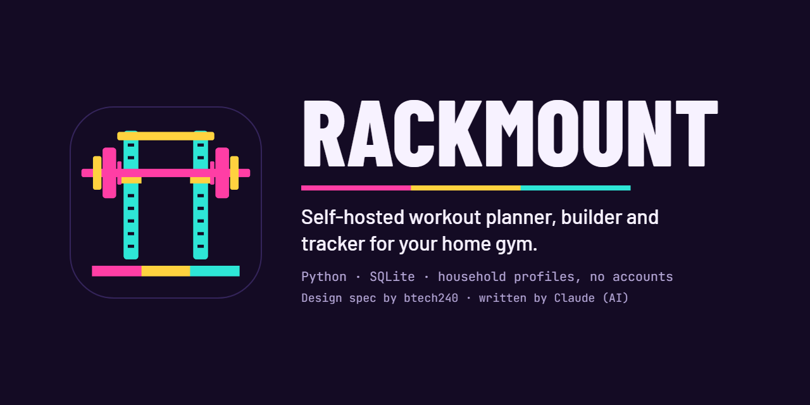

> **AI-produced.** Design spec by btech240, written by Claude (Anthropic's AI). The code, docs and artwork in this repo were generated by Claude from that spec.

Tell it what equipment you have, and each day it builds a strength workout around your most-recovered muscles, keeps your main lifts coming back so you can progress them, and suggests the weight or reps for every set from what you did last time. It runs as a small Python web app on your home server and you use it from your phone's browser.

## Why it exists

Apps that plan your workout for you are usually subscriptions that keep your training history on someone else's servers and only roughly know what equipment you own. Rackmount does that planning on your own hardware instead: no account, no subscription, your history stays in one file at home, and every suggestion is built from the exact weights and equipment in your gym. Everyone in the house can use it, each with their own history.

> **No login, by design.** It's a household app: anyone who can reach it can pick any profile and use every feature. Run it on your **home network**, and to use it away from home, reach it through **Tailscale, WireGuard or a similar private VPN**. Never port-forward it or put it on the public internet. See [Security](docs/SECURITY.md).

## What it does

- **Daily workouts** — Push, Pull, Legs, Upper, Lower or Full body, chosen by which muscles are most recovered. **Swap**, **Remove** or **Add** exercises (suggested, or picked from a searchable list), or get **New exercises** for the same day.
- **Real equipment** — only exercises your gym supports (barbell + plates, EZ bar, trap bar, dumbbells, kettlebells, cable stack with high/low/mid pulleys, bands, a dozen kinds of machines, bench, rack, pull-up bar, dip station, plyo box, ab wheel, stability and medicine balls, suspension trainer and more), set up once on the shared **Gym** tab, and only weights you can actually load.
- **Progression** — weight suggestions from your last session (up one loadable step when you hit every rep); rep targets that climb for bodyweight moves.
- **Core lifts + variety** — a couple of main lifts per muscle keep coming back; the rest rotate. Pin favorites, exclude ones you never want.
- **Fast logging** — a set table with last session's numbers beside each set, one tap to log, and a rest timer that beeps when rest is over.
- **Form help** — step-by-step instructions with start/end position photos.
- **History and recovery** — every finished workout, and how recovered each muscle group is.
- **Household profiles** — "Who's working out?" on open, no passwords. Each person has their own workouts, goal, pins and exclusions; the gym's equipment is shared.

## Documentation

| Doc | For |
|-----|-----|
| **[User guide](docs/USER_GUIDE.md)** | Everyone in the house: setup on your phone, the daily workout, settings, how workouts are picked, troubleshooting. |
| **[Deploy](docs/DEPLOY.md)** | Whoever runs the server: creating the Proxmox container, installing, updating, backups. |
| **[Security](docs/SECURITY.md)** | What's protected, what isn't, and how to lock down container access. |
| [Design decisions](docs/DECISIONS.md) | Why things work the way they do. |

## Run it

| Where | How | Tested? |
|-------|-----|---------|
| **Proxmox LXC (Debian 12)** | `deploy/install.sh`, a hardened systemd service | **Yes**: this is the only setup the author runs and has tested. |
| Any other Debian / Ubuntu machine (VM, mini-PC, Raspberry Pi) | the same `deploy/install.sh`, skipping the Proxmox step | Not yet. It should work, but it's untested. |
| Docker (Synology, Unraid, TrueNAS, Docker Desktop, …) | `docker compose` | Not yet. It should work, but it's untested. |

If you try an untested route, please report back whether it worked.

### Proxmox LXC or another Debian/Ubuntu machine

Full steps: **[docs/DEPLOY.md](docs/DEPLOY.md)**. In short, inside the container or machine:

```sh
git clone git@github.com:<owner>/rackmount.git /opt/fitness-planner
bash /opt/fitness-planner/deploy/install.sh     # first time
bash /opt/fitness-planner/deploy/update.sh      # every update after that
```

Then open `http://<container-ip>:8000` on a phone on the home Wi-Fi, add yourself as a person, and fill in the **Gym** tab.

There is no login by design: keep it on the home network and never port-forward it. For use away from home, see [Away from home](docs/SECURITY.md#away-from-home-tailscale-or-a-vpn).

### Docker (untested)

1. Get the code: `git clone https://github.com/<owner>/rackmount.git && cd rackmount`.
2. Edit `compose.yaml`:
   - `TZ`: your timezone.
   - `FP_ALLOWED_HOSTS`: replace `192.168.1.50` with your server's IP, and add any hostname or Tailscale name you'll use. Anything not listed gets "Unknown host name for this app."
3. `mkdir -p data && sudo chown 1000:1000 data` (the app runs as user 1000; on Docker Desktop the `chown` isn't needed).
4. `docker compose up -d --build`. On first start it downloads the form photos (~60 MB) before the app comes up; after that, starts are quick.

Everything lives in `./data`: the database (`data/fitness.db`) and photos (`data/photos`). Back up that folder. **Update:** `git pull && docker compose up -d --build`.

The container runs as a non-root user with a read-only filesystem, no Linux capabilities and no privilege escalation. The LXC install adds a stricter systemd sandbox on top of that.

## How it decides

- **Recovery:** each logged set adds fatigue to the muscles it works (primary 1.0, secondary 0.5), which fades over 72 hours. 10 sets takes a muscle to 0%. Muscles at 60% or above can be picked.
- **Day pattern:** each workout is Push, Pull, Legs, Upper, Lower or Full body, whichever pattern's main muscles are most recovered. It won't repeat the previous workout's pattern unless that pattern is clearly the freshest.
- **Slots:** exercises are handed out round-robin over the pattern's recovered muscles (below 60% recovery gets nothing).
- **Core lifts + rotation:** a muscle's first slot goes to one of its 2 core lifts: pinned ones first, then your most-logged, then defaults like Bench Press and Squat. The two core lifts alternate between sessions. Extra slots rotate through other variations, avoiding what you did recently or often, Olympic lifts, and bodyweight filler when you have weights.
- **No near-duplicates:** exercises in the same family (e.g. any pull-up/chin-up, any squat, any flat press) never share a workout.
- **Weights:** it estimates your one-rep max from last session's best set and converts it to today's rep target. If you hit every rep last time, it goes up one loadable step (at most +15%). Suggestions are always weights your inventory can actually load. The first time you do an exercise, you choose the weight.
- **Bodyweight moves:** the rep target is last session's average + 1, up to the goal's reps + 5. Once you hit that on every set, it suggests adding weight.
- **Cable stack:** each cable exercise is tagged high, low or mid pulley; tick the positions you have.

All of this is per profile. Tuning knobs are constants at the top of `app/generator.py` and `app/recovery.py`.

## Develop

```sh
python -m venv .venv
.venv/Scripts/pip install -r requirements-dev.txt     # .venv/bin/pip on Linux/macOS
.venv/Scripts/python -m pytest
.venv/Scripts/python -m app.fetch_photos               # optional: form photos into data/photos
.venv/Scripts/python -m uvicorn app.main:app --port 8000
```

## License

[MIT](LICENSE). The app icon is drawn in `scripts/build_icons.py` (run it with Pillow installed to regenerate the PNGs in `app/static`). Exercise data and photos come from [free-exercise-db](https://github.com/yuhonas/free-exercise-db) (public domain). To refresh the data, see `scripts/build_exercises.py`.
