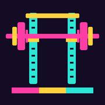

# Rackmount — User Guide

Rackmount builds you a strength workout each day from the equipment in your home gym. It rotates muscle groups so tired muscles get time to recover, keeps a few main lifts coming back so you can progress them, and suggests the weight (or reps) for every set based on what you did last time.

Everyone in the house can have their own profile. There are no passwords: you just pick your name.

---

## Getting started

1. **Open the app** on your phone while you're on the home Wi-Fi. Ask whoever runs it for the address; it looks like `http://192.168.x.y:8000`.
2. **Add it to your home screen** (iPhone: Share → **Add to Home Screen**). It then opens full-screen like an app, with the Rackmount icon:

   

   Added it before the icon existed and see a plain letter instead? Delete the home-screen icon and add it again from Safari; iPhone only picks up the icon when you add it. Your workouts aren't affected.
3. **Pick your name** on *Who's working out?*, or tap **Add person** and enter:
   - your **name**,
   - your **training goal** (see [Goals](#goals)),
   - how many **exercises per workout** you want (2–10; 5 is a good start).
4. Your phone remembers you from now on and opens straight to **Today**.

The first person to set up the app should also fill in the gym's equipment on the **Gym** tab (see [Gym tab](#gym-tab-shared-with-everyone)). Everyone shares that list.

---

## Your daily workout (Today)

### Starting a workout
Tap **Generate workout**. The app picks a **day type** (shown as the title, e.g. *Pull day*) and a set of exercises for it. Under the title you'll see:

- the goal summary, e.g. `HYP · 3×10 · 90s` = muscle building, 3 sets of 10, 90 seconds rest;
- how recovered the day's target muscles are (bars fill up as they recover).

Don't like the selection? Tap **New exercises** at the bottom: you get the same type of day with all different exercises, and tapping again keeps finding new ones. **Discard** drops the workout. Both are only there before you've logged your first set.

To change just one exercise, use **Swap** or **Remove** on its card (below).

### Exercise cards
Each exercise is a card. Finished ones collapse with a ✓; the one you're on opens automatically. Tap any card to open or close it.

An open card shows a **set table**:

| Column | Meaning |
|--------|---------|
| **Set** | Set number. Aqua = done, pink = the one you're on. |
| **Prev** | What you did on that set last time, e.g. `10·45` = 10 reps at 45 lb, `8·BW` = 8 bodyweight reps. |
| **Reps / lb** | The current row has boxes, pre-filled with the target reps and suggested weight. Change them to what you actually did. |
| **✓** | Logs the set. **✕** on a logged set deletes it if you made a mistake. |

Logging a set starts the **rest timer** (see below) and moves you to the next set.

**First time doing an exercise?** There's no weight suggestion yet; pick one you can do for the target reps with good form. After that the app suggests weights for you.

### Rest timer
After each set, a pink bar at the bottom counts down your rest (length depends on your goal).

- When rest is over it **beeps**, shows **Go** for a few seconds, and disappears. Nothing to tap.
- **Skip** ends the rest early.
- The **speaker button** turns the beep off/on for your phone. Turning it on plays the beep once, so you can check your volume.
- The beep plays **over your music** (it doesn't pause it), but it follows the ring/silent switch: on silent, you only get the on-screen timer. A reminder sits under the timer.
- If the line under the timer says **Sound paused**, tap anywhere. iPhones cut a web page's sound after the screen locks, you switch apps, or a call comes in.
- iPhone notes: the beep only plays while the app is open on screen (set **Auto-Lock** to 5 minutes or more), and iPhones can't vibrate for websites.

### How to (with photos)
Open **How to** on any card for step-by-step instructions, with **start** and **end** position photos underneath. Tap a photo to see it full size.

### Changing today's workout
On an open card, before you've logged a set on that exercise:

- **Swap** — replaces it with the next-best exercise for the same muscle. Tap again for another; an exercise you swapped away won't come back in this workout.
- **Remove** — takes it out of today's workout. (You can't remove the last one.)

Neither one changes what the app suggests on other days. Once you log a set on an exercise, its Swap and Remove buttons disappear.

### Adding an exercise
Want more? Below the last exercise there's an **Add exercise** box, usable any time before you finish, even mid-workout:

- **Suggest one** — one tap adds the best fit for today's least-worked muscle (it shows which, e.g. *Best fit for Legs day · hamstrings*). Tap again for another.
- **Choose myself** — opens a list where you pick any exercise your gym supports. Today's muscles are at the top (**Other muscles…** shows the rest), sorted best first, with when you last did each one. Or **search** by name, e.g. *curl* or *row*. Tap **+** to add it.

Added exercises go to the end, get the usual sets, reps and weight suggestions, and can be swapped or removed like any other. Exercises already in the workout are marked **✓ In**; Never-suggest ones don't appear.

### Shaping what you get
At the bottom of each card:

- **Pin as core lift** — always include this exercise whenever its muscle is trained. Use it for your favorite main lifts. Tap **Unpin core lift** to undo.
- **Never suggest this** — you'll never get this exercise again (bad fit, injury, don't like it). The app swaps in another one right away. You can allow it again in Settings.

### Finishing
Tap **Finish workout** when you're done (skipped sets are fine). It moves to **History**. If you didn't log anything, the workout is simply discarded.

---

## History
Your finished workouts, newest first: date, goal, and every set you logged (`10×45` = 10 reps at 45 lb).

## Recovery
How recovered each muscle group is, from 0% (just worked hard) to 100% (fresh). It's based on the sets you logged in the last 3 days. Muscles at **60% or more** can be picked for a workout; lower ones show in yellow and get left alone.

---

## Gym tab (shared with everyone)

One list for the whole house; changes apply to every profile. Tick what you have, then:

| Equipment | How to enter it |
|-----------|-----------------|
| **Barbell / EZ curl bar / trap bar** | Bar weight. Plates are entered once below and shared by all three bars. |
| **Dumbbells** | **From / To / Step** for one dumbbell, e.g. 5 / 50 / 5 for a 5–50 lb set. Adjustables: lightest, heaviest, and the jump between settings (e.g. 5 / 52.5 / 2.5). |
| **Kettlebells** | Tap each weight you own. |
| **Cable stack** | **From / To / Step** of the weight stack, plus which **pulley positions** you have (High, Low, Mid). Exercises that need a position you don't have are skipped. |
| **Resistance bands** | Just tick it. |
| **Plates** | How many **pairs** you own of each size (one for each side of the bar). With a bar ticked, single-plate exercises (plate raise, pinch, twist) are included too. |
| **Stations** | Bench, squat rack/stands, pull-up bar, dip station / parallel bars, plyo box, glute-ham / back-extension bench. |
| **Machines** | Tick the ones you have: Smith machine, leg press / hack squat, leg extension / curl, calf raise, hip abductor / adductor, pec deck, chest & shoulder press, arm machines, ab crunch, assisted dip, plate-loaded lever machines, reverse hyper. Machine weights are suggested in 5 lb (2.5 kg) steps. |
| **Other gear** | Ab wheel, exercise ball, medicine ball, suspension trainer or rings, sled, battle ropes, wrist roller, sandbag. Reps go up over time like bodyweight moves. |

Bodyweight exercises are always available. After saving, the app tells you how many exercises fit the gym.

**Olympic lifts, jumps, throws and carries** (clean, snatch, push press, box jumps, medicine-ball throws, Farmer's Walk, sled work) are never picked for you, but you can add them to any workout with **Add exercise → Choose myself** when you have the gear.

---

## Settings

### Profile (top of Settings)
- **Switch profile** — goes back to *Who's working out?*. Use it when you hand your phone to someone else.
- **Rename** — change your name.
- **Delete profile** (bottom of Settings) — permanently erases your workouts, history and settings. Type your name to unlock the button.

### Training (just for you)
- **Goal** — sets reps, sets and rest time:

  

  | Goal | Sets × reps | Rest |
  |------|-------------|------|
  | Strength | 4 × 5 | 180 s |
  | Muscle building | 3 × 10 | 90 s |
  | Endurance | 3 × 15 | 45 s |

- **Exercises per workout** — 2 to 10.
- **Units** — lb or kg.

Changes apply to your *next* workout. If one is already showing, tap **New exercises** (before logging anything) to rebuild it.

### Core lifts and Never suggest (just for you)
Lists of what you've pinned and excluded, with **Unpin** / **Allow again** buttons.

---

## How workouts are picked

You don't need to know this to use the app, but it explains what you'll see:

- **Day types.** Each workout is Push, Pull, Legs, Upper, Lower or Full body, whichever group of muscles is most recovered. It avoids repeating yesterday's type.
- **Recovery.** Every set you log tires the muscles it works; that fades over about 3 days.
- **Core lifts + variety.** Each muscle has a couple of main lifts (your pins first, then what you've done most, then classics like bench press and squat) that come back regularly so you can add weight. Other slots rotate through different exercises so things stay fresh.
- **No doubling up.** You won't get two near-identical moves (e.g. pull-ups *and* chin-ups) in one workout.
- **Weights.** Based on your best set last time. Hit every rep and it goes up one step your equipment can actually load (never more than +15%); miss reps and it holds or eases off.
- **Bodyweight moves.** Reps go up by about one per session (to your goal's reps + 5); once you hit that on every set, it suggests adding weight.

---

## Tips and troubleshooting

- **Looks wrong after an update?** Close the app fully and reopen it. If it still looks off: iPhone Settings → Safari → Advanced → Website Data → delete the entry for the app's address.
- **No beep?** Make sure you tapped something after opening the page (logging a set counts), the speaker on the rest bar isn't muted, and the phone's ring/silent switch isn't set to silent. If it stopped partway through a workout, tap anywhere on the page to bring it back.
- **Wrong person's workout?** Settings → **Switch profile**.
- **An exercise needs equipment you don't have?** Check the **Gym** tab (e.g. cable pulley positions, stations, machines), or tap **Never suggest this**.
- **Only works at home?** The app is only reachable on the home network, unless whoever runs the server has set up Tailscale or a VPN for use away from home.
